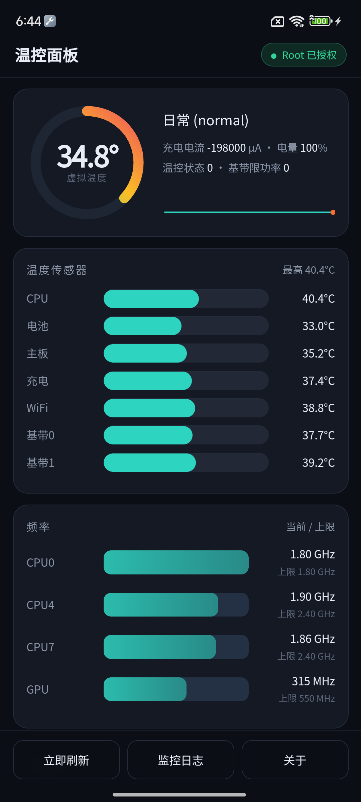

<div align="center">

# MiThermalTuner

**小米温控实时监控与调节 —— 图形界面 + Magisk 模块**

**作者：达人怪**  ·  微信 `UVWAPP`

[](LICENSE)


</div>

---

## 这是什么

小米设备上的温控参数（降频阈值、充电限流、GPU/基带限功率…）全部放在
`/vendor/etc/thermal-*.conf` 里，并且被 **AES-128-CBC 加密** —— 密钥硬编码在
`mi_thermald` 二进制中。普通用户和绝大多数脚本都读不到、改不了。

**MiThermalTuner** 把这层加密剥掉：

* 在设备端用 **busybox awk** 重新实现了小米同款 AES-128-CBC，
  **加解密结果与原厂密文逐字节一致**
* 解密全部 16 个场景配置，改完后重新加密写回 `mi_thermald` 的配置目录并重启它
* 提供**原生图形界面 App**（温控面板）和等价的命令行接口
* 常驻监控温控状态、真实温度、实际频率、充电电流、生效中的散热设备

<div align="center">
  
</div>

### 联系

| | |
|---|---|
| 作者 | **达人怪** |
| 微信 | **UVWAPP** |
| Issue | <https://github.com/colorXi/MiThermalTuner/issues> |

---

## 兼容性

| 项目 | 要求 |
|---|---|
| 设备 | 搭载 `mi_thermald` 的小米设备（本项目在 Redmi Note 10 Pro 5G `2109119BC` / SM7325 / **小米澎湃OS HyperOS `OS1.0.2.0.TKVCNXM`（基于 Android 13）** 上验证） |
| Root | Magisk / KernelSU / APATCH 任一，需要 `su` |
| 底层 | 内核需有 `CONFIG_THERMAL`（几乎所有高通/联发科机型都有） |
| Shell | 需 busybox 提供 `awk`（**必须**带 `xor()` / `lshift()`，toybox awk 不行） |

> Magisk 30.x 起已移除模块 WebUI 支持，因此图形界面做成独立 App，
> 安装模块时会自动装上，桌面出现「温控面板」图标。

---

## 安装

### 方式一：Magisk / KernelSU

1. 下载 `MiThermalTuner.zip`
2. 推送到手机：`adb push MiThermalTuner.zip /sdcard/Download/`
3. 在 Magisk / KernelSU App 里安装该 zip，重启

安装脚本会自检 `mi_thermald` 是否存在、busybox awk 是否支持 `xor()`，
并自动安装图形界面 App。

### 方式二：手动

```bash
adb push MiThermalTuner.zip /data/local/tmp/
# 解压到 /data/adb/modules/mi_thermal_tuner 后重启
```

### 图形界面 App

模块安装后自动装好，也可以单独安装：

```bash
adb install MiThermal.apk
```

**首次打开需要授予 Root 权限**（Magisk 会弹窗询问）。

---

## 图形界面用法

| 区域 | 说明 |
|---|---|
| **顶部仪表盘** | 虚拟温度环形进度条 + 温度历史曲线；显示当前生效场景、充电电流、电量、温控状态、基带限功率 |
| **温度传感器** | 7 路传感器（CPU / 电池 / 主板 / 充电 / WiFi / 基带×2）实时条形图 |
| **频率** | CPU0 / CPU4 / CPU7 / GPU 的当前频率与上限对比 |
| **温控预设** | 原厂 / cool / game / mild / unlock 一键切换 |
| **实时限制** | 大核·超大核·GPU 上限滑块、充电限流档位 ±、系统温控状态分段按钮 |
| **散热设备** | 当前所有 `cur_state != 0` 的散热设备及档位（介入中的高亮） |
| **场景配置编辑** | 场景 → 节 → 键 三级联动，自动读出当前值；「保存并应用」即加密写回并重启 `mi_thermald` |

---

## 命令行用法

```bash
# ---- 实时监控 ----
mt status                    # 状态快照
mt watch                     # 前台实时监控，每 3 秒刷新
mt log -n 200                # 看后台监控日志
mt json                      # 全部状态 (JSON, 给脚本用)

# ---- 场景配置 ----
mt scenarios                 # 列出所有场景
mt show thermal-normal.conf  # 查看某场景明文配置
mt decrypt                   # 重新解密全部场景 (OTA 升级后用)
mt sections thermal-normal.conf   # 列出某场景的节和可改的键 (JSON)

# ---- 修改阈值 ----
# 语法: mt set <场景> <节名> <键> <新值...>
mt set thermal-normal.conf MONITOR-SS-CPU4 trig "50000 51000 52000 53000 54000"
mt set thermal-normal.conf VIRTUAL-SENSOR weight "-155 424 -8 86 -3 237 288"

# ---- 预设 ----
mt profile list              # cool / mild / unlock / game
mt profile apply unlock      # 应用预设
mt restore                   # 移除全部场景覆写, 恢复原厂

# ---- 实时覆写 (sysfs, 即时生效) ----
mt cap cpu 4 1516800         # 限制大核上限 (policy 0/4/7)
mt cap cpu 4 off
mt cap gpu 315000000         # 限制 GPU 上限
mt cap charge 3              # 充电限流档位 0-16
mt tempstate 2               # 强制系统温控状态
mt overrides                 # 查看当前所有实时覆写
mt reset                     # 清除全部实时覆写
```

---

## 工作原理

```
/sys/class/thermal/thermal_zone*       内核 89 个温区 (step_wise / user_space)
        ↓
android.hardware.thermal@2.0-service.qti    Qualcomm Thermal HAL
        ↓
mi_thermald    ← 本项目的主要目标
   优先读 /data/vendor/thermal/config/thermal-*.conf   (覆写)
   回退到 /vendor/etc/thermal-*.conf                    (原厂)
   写 /sys/class/thermal/cooling_device*/cur_state
        ↓
CPU 降频 / GPU 降频 / 充电限流 / 背光 / 基带限功率 / 拔核
```

### 配置文件优先级

`mi_thermald` 会优先读 `/data/vendor/thermal/config/`（init 以 `0771 root:system` 创建），
找不到才回退 `/vendor/etc/`。
本项目**只写前者，从不修改 `/vendor/etc`**，所以卸载模块后立即回到原厂状态。

### 覆写生效流程

```
明文缓存 /data/adb/mi_thermal/plain/thermal-xxx.conf
   → AES-128-CBC 加密 (key = iv = "thermalopenssl.h")
   → /data/vendor/thermal/config/thermal-xxx.conf
   → setprop ctl.restart mi_thermald
   → mi_thermald 重新解密并加载
```

`mt status` 里显示的「当前生效的场景配置」就是从
`/data/vendor/thermal/decrypt.txt` 反查出来的。

### 设备端 AES 实现

`module/bin/mtaes.awk` / `module/bin/mtdec.awk` 是纯 busybox awk 实现的 AES-128-CBC。

两个踩坑点（已处理）：

1. Android 自带的 `/system/bin/awk`（toybox）**没有** `xor()` / `lshift()`，
   必须用 Magisk busybox 的 awk
2. awk 里的 `^` 是**幂运算**不是异或，异或要用 `xor()` 函数

配置文件的完整格式、虚拟温度算法、字段语义见
**[`docs/thermal-config-format.md`](docs/thermal-config-format.md)**。

---

## 监控日志

```
/data/adb/mi_thermal/monitor.log
```

CSV 格式，超过 2 MB 自动轮转为 `monitor.log.1`：

```
# time,virtual,quiet,cpu,batt,charger,wifi,m0,m1,cpu0,cpu4,cpu7,gpu,current_uA,level,temp_state,cooling
10-20 17:20:01,35200,34900,38800,33100,37200,39100,37100,38900,691200,2400000,806400,315000000,0,100,0,panel0-backlight=4095
```

`virtual` 取自 `mi_thermald` 自己的 `/data/vendor/thermal/thermal.dump`
（厂商算法算出的加权虚拟温度），其余为 sysfs 直读值。

---

## 电脑端工具

```bash
pip install pycryptodome

python tools/mt_editor.py pull                # 拉取全部场景(解密)到 ./mt_conf
notepad .\mt_conf\thermal-normal.conf         # 随便改
python tools/mt_editor.py push thermal-normal.conf .\mt_conf\thermal-normal.conf
python tools/mt_editor.py pushall .\mt_conf    # 批量推送
python tools/mt_editor.py dump                 # 导出设备当前实际生效的配置
python tools/mt_editor.py restore              # 恢复原厂
```

---

## 从源码构建

### App

```bash
python tools/build_apk.py
```

需要 JDK 17+ 和 Android SDK（`build-tools` + `platforms`）。
**不需要 Gradle** —— 脚本直接调用 `aapt2` / `javac` / `d8` / `zipalign` / `apksigner`。

> `app/mithermal.keystore` 是**公开的 debug 签名密钥**，仅为保证社区版能覆盖升级。
> 自己 fork 发布时请换掉它。

### Magisk 模块 zip

```bash
python tools/build_module_zip.py     # -> dist/MiThermalTuner.zip
```

### 目录结构

```
.
├── module/                  Magisk 模块
│   ├── module.prop
│   ├── customize.sh         安装脚本(自检 + 自动装 App)
│   ├── post-fs-data.sh
│   ├── service.sh           装 App + 拉起监控守护
│   ├── uninstall.sh
│   ├── app/MiThermal.apk
│   ├── bin/{mt,mtaes.awk,mtdec.awk}
│   ├── lib/{common.sh,monitor.sh}
│   └── profiles/*.profile
├── app/                     App 源码
│   ├── AndroidManifest.xml
│   ├── assets/index.html    界面 (HTML/CSS/JS)
│   ├── java/.../MainActivity.java
│   ├── res/
│   └── mithermal.keystore
├── tools/
│   ├── build_apk.py
│   ├── build_module_zip.py
│   ├── mt_editor.py
│   └── decrypt_tool.py
├── reference/decrypted/     16 个场景的明文配置 (供研究)
├── docs/
│   ├── ui.png
│   └── thermal-config-format.md
└── .github/workflows/build.yml
```

---

## 卸载

Magisk / KernelSU 里直接卸载模块，或手动：

```bash
sh /data/adb/modules/mi_thermal_tuner/uninstall.sh
```

卸载脚本会：移除全部场景覆写 → 重启 `mi_thermald` → 恢复 CPU/GPU 频率上限 →
解除充电限流 → 删除 `/data/adb/mi_thermal`。
图形界面 App 需自行卸载。

---

## 注意事项

* 本项目只做**参数**层面的调节，不改内核、不改驱动
* 解除温控限制会显著增加发热和耗电，长期使用请自行评估（尤其夏天）
* `mi_thermald` 重启瞬间（约 1-2 秒）温控策略短暂失效，属正常现象
* 系统 OTA 升级后建议执行一次 `mt decrypt` 刷新配置缓存
* 各机型配置格式可能不同，如果 `mt show` 出来的内容不对，说明该机型的
  `mi_thermald` 用了不同的配置结构，欢迎提 issue 附上原文

---

## 免责声明

本项目仅供研究、个人设备调校与学习使用。使用者需自行承担全部风险。
作者不对因使用本项目导致的任何设备损坏、数据丢失或人身伤害负责。
`mi_thermald` 及其配置文件属于小米 / 高通的所有，本项目不包含任何厂商代码，
配置文件内容由使用者本人设备上的工具在本地解析得出。

---

## 作者

<div align="center">

**达人怪**
微信 `UVWAPP`

小米温控调校 · 设备折腾 · 逆向分析

</div>

---

## License

[GPL-3.0](LICENSE)

---

<div align="center">

**English summary**

MiThermalTuner unlocks the thermal-throttling parameters on Xiaomi devices.
They live in `/vendor/etc/thermal-*.conf`, AES-128-CBC encrypted with a key
hardcoded in the `mi_thermald` binary. This project reimplements that exact
cipher in **busybox awk** (byte-identical to the vendor ciphertext), so the
configs can be read, edited and re-applied on-device.

It ships a **native Android GUI** (WebView-based, dark themed) plus a full CLI.
Scenarios are overridden in `/data/vendor/thermal/config/` — the directory
`mi_thermald` prefers over `/vendor/etc` — so the module never touches vendor
files and uninstalling restores the stock behaviour immediately.

* Requires: a Xiaomi device running `mi_thermald`, root (Magisk/KernelSU),
  and a busybox with a working `awk` (toybox's awk lacks `xor()`).
* Build the app with `python tools/build_apk.py` — no Gradle needed.
* Author: **达人怪** (WeChat: `UVWAPP`) · Licensed under GPL-3.0.

</div>
